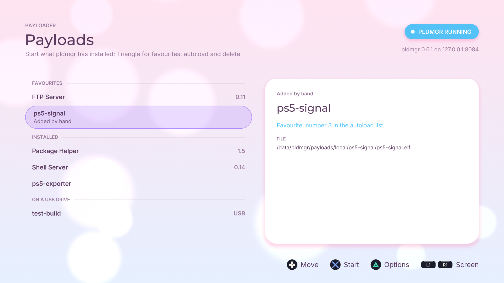
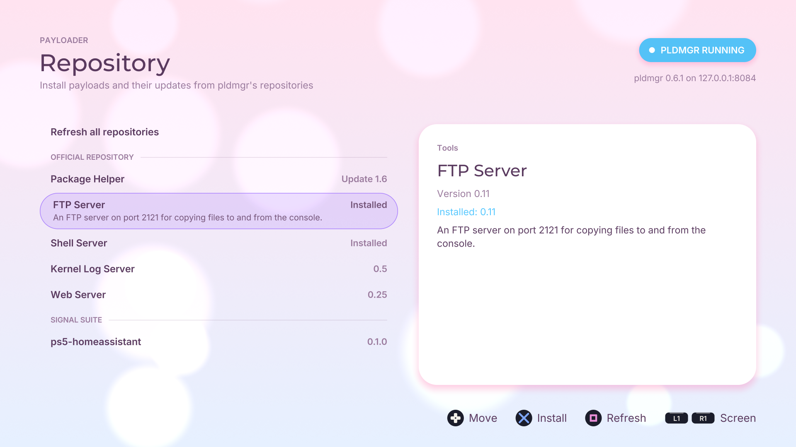
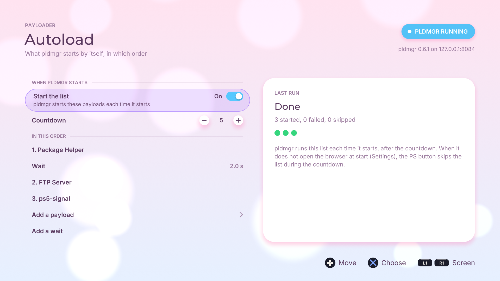
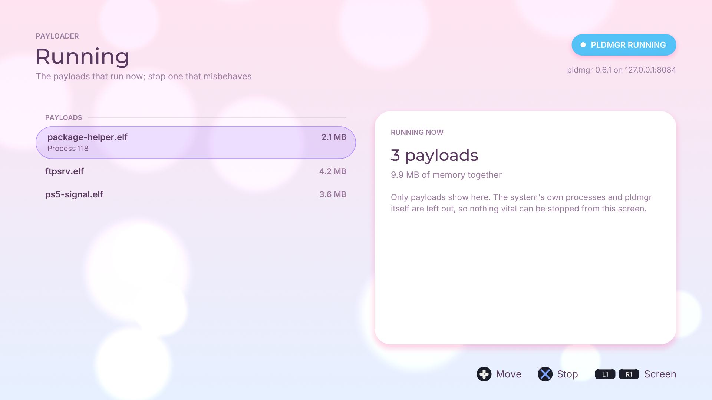
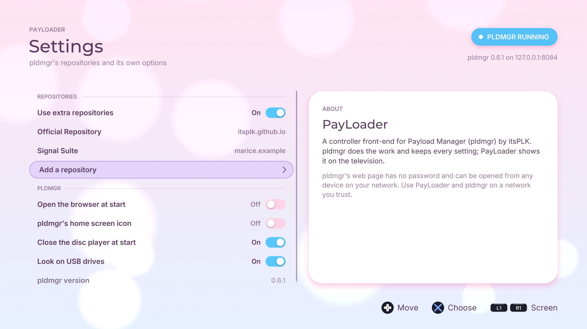

# PayLoader

A PS5 homebrew app (PPSA69427) that lets you manage your payloads with the controller, on the television. It is a
front-end for [Payload Manager](https://github.com/itsPLK/ps5-payload-manager) (pldmgr) by itsPLK. pldmgr does the
work and keeps every setting; PayLoader shows it as a console app, so you do not need a browser.

**Status:** not yet tested on a console. The screens below show made-up preview data.



## What you need

- A PS5 that runs homebrew apps (for example with etaHEN).
- **pldmgr 0.6.0 or newer**, running. PayLoader talks to it on `127.0.0.1:8084` and does nothing by itself. The newest
  autoloaders for Y2JB, BD-JB and Lua include pldmgr; otherwise load `pldmgr.elf` yourself.

## Quick start

1. **Start pldmgr:** with your autoloader, or send `pldmgr.elf` to your ELF loader (etaHEN: port 9021).
2. **Install PayLoader:** unzip the [release](https://github.com/Marice/ps5-payloader/releases/latest) and copy the
   `PPSA69427` folder to `/data/homebrew/` on the console (FTP).
3. **Open it.** **L1** and **R1** move between the screens; the **touchpad** explains the screen you are on.

When pldmgr does not run, every screen says how to start it and checks again every 3 seconds.

## The screens

| Screen | What it does |
| --- | --- |
| **Payloads** | The payloads pldmgr has installed, favourites first, then the ones on a USB drive. **Cross** starts one. **Triangle** opens its menu: favourite, start with the autoload list, delete. |
| **Repository** | The payloads in pldmgr's repositories. Each row says if it is installed, or which update is ready. **Cross** installs or updates; **Square** refreshes every repository. When the same payload is installed from another repository, PayLoader asks before it replaces it. |
| **Autoload** | The list pldmgr starts by itself: on or off, the countdown, and the payloads in order with waits between them. **Cross** on an entry moves it, changes a wait or removes it. While pldmgr runs the list, the screen shows its progress and can stop it. |
| **Running** | The payloads that run now, with their memory. **Cross** stops one, after it asks. The system's own processes and pldmgr itself are not listed. |
| **Settings** | pldmgr's repositories (add one by its address, remove one) and its options: extra repositories, the browser at start, its own home screen icon, the disc player, USB drives. |

<p>


</p>
<p>


</p>

## How it works

PayLoader calls pldmgr's HTTP API on `127.0.0.1:8084`, the same API that pldmgr's web page uses. Reads are `GET`;
changes are `POST` with the header `X-PLDMGR-Request: 1`. The API has no version of its own, so PayLoader checks
pldmgr's version first (`/version`) and reads every field with a fallback.

| Screen | Calls |
| --- | --- |
| Payloads | `GET /list_payloads`, `GET /get_config`, `POST /loadpayload:<slot>`, `POST /manage:delete`, `POST /set_config` (favourites, autoload list) |
| Repository | `GET /repository_payloads`, `POST /repository_refresh`, `POST /repository_install` |
| Autoload | `GET /autoload_status`, `POST /set_config`, `POST /abort` |
| Running | `GET /processes_list`, `POST /process_kill` |
| Settings | `GET /sources_list`, `POST /sources_add`, `POST /sources_remove`, `POST /set_config` |

Every request runs on a background thread, so the screen never waits for pldmgr. A screen asks only for what it shows.

**Security.** pldmgr's web page has no password and listens on every network address (port 8084). Anyone on your
network can open it. This is how pldmgr works, not something PayLoader adds or can change. Use them on a network you
trust.

## Building

The app is built on [ps5-homebrew-ui](https://github.com/blackbearreloaded/ps5-homebrew-ui) by BlackBearReloaded.

```bash
docker build -t payloader-build docker/      # once
docker/run.sh make test-unit                  # unit tests, sanitizers on
docker/run.sh make                            # the app folder in dist/PPSA69427
docker/run.sh make lint                       # format, static analysis, metadata
docker/run.sh tools/host-snapshots.sh build/snapshots all   # pictures of every screen
```

The pictures use a pretend pldmgr with made-up payloads (`src/payloader/demo.cpp`); `PAYLOADER_OFFLINE=1` shows the
screens without one. The guides of the UI kit are in [docs/KIT_README.md](docs/KIT_README.md).

## Credits and licence

- [Payload Manager (pldmgr)](https://github.com/itsPLK/ps5-payload-manager) by itsPLK: the payload that PayLoader
  controls. PayLoader follows the rules of pldmgr's web page for versions, updates and conflicts.
- [ps5-homebrew-ui](https://github.com/blackbearreloaded/ps5-homebrew-ui) by BlackBearReloaded: the UI kit.

PayLoader is licensed under the GNU General Public License v3.0 or later. See [LICENSE](LICENSE) and
[THIRD_PARTY_NOTICES.md](THIRD_PARTY_NOTICES.md).
